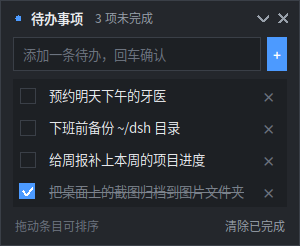
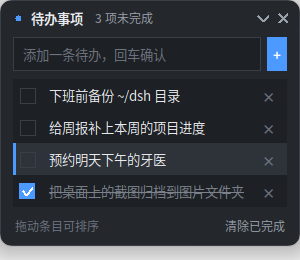
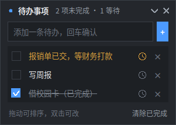
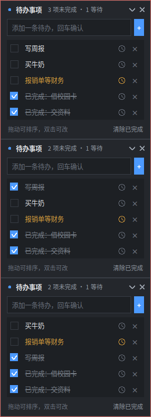
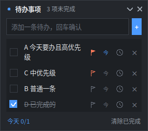
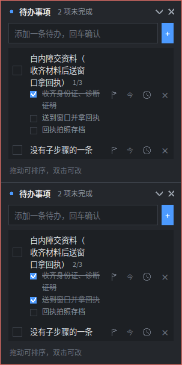
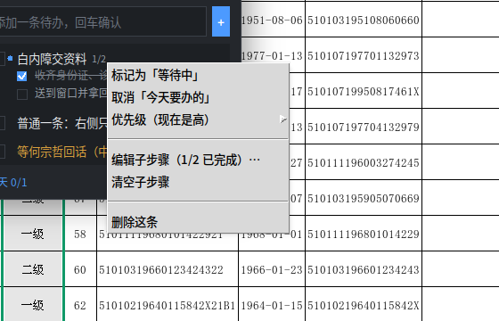

# 桌面待办清单挂件

> 常驻桌面右上角的小窗口：**无标题栏、可拖动**，回车就能记一条待办，
> **条目可以按住上下拖动排序**，所有改动立即存盘，重开自动恢复待办内容、
> 顺序和窗口位置。
>
> 同一份代码在 **统信 UOS / Deepin（X11）** 与 **Windows 11** 上都跑：单文件、
> 只用 Python 标准库、零第三方依赖。
>
> **默认不置顶**：它就是普通窗口，别的窗口盖上来就把它盖住，不会一直挡在前面。
> **它也不在任务栏 / dock 里显示图标**；Windows 上会在右下托盘挂一个图标，
> **左键唤回窗口、右键弹出菜单**（Linux 侧见「平台差异」）。
> 也可以**再运行一次同样的命令**把它叫到最前面——不会开出第二个窗口；
> Linux 上还能按全局快捷键 **`Super+T`** 一键唤回。
> 确实想让它一直浮在最上面时，在右键菜单里勾「始终置顶」（勾选状态会记住）。
>
> 每件事有**三种状态**：未完成 / **等待中**（已着手，但在等别人反馈）/ 已完成。



拖动排序时，被拖的条目会高亮（浅底 + 左侧蓝条），跟着指针实时换位：



## 快速开始

只需要 Python 3 + tkinter，单文件、无第三方依赖。

**统信 UOS / Deepin（X11）**：

```bash
sudo apt install python3-tk      # 统信 UOS 默认不带 tkinter，第一次用要装一次
cd desktop-todo                  # 本项目所在目录
python3 desktop_todo.py
```

（没装 tkinter 时，`--check` / `--doctor` 会直接告诉你要装 `python3-tk`，
而不是只抛一句 `No module named 'tkinter'`。）

**Windows 11**：

```powershell
cd D:\个人项目\desktop-todo
python desktop_todo.py
```

- **Windows 上右下托盘会有一个图标**：左键唤回窗口，右键弹出与本程序一致的菜单
  （含「隐藏窗口」「退出」）。Windows 11 默认把新图标收进托盘的溢出区（点托盘左边的
  `^` 能看到），把它拖到常显位置就会一直露着。排障时可以设 `DESKTOP_TODO_VERBOSE=1`
  启动，程序会额外打印窗口后端、托盘是否挂上、数据文件路径。
- **再运行一次同样的命令 = 把已经在跑的窗口叫到最前面**（不会开出第二个窗口）。
  它不在任务栏里，所以这也是最顺手的唤回方式；`Alt+Tab` 里能不能找到它取决于平台
  （Windows 上 `WS_EX_TOOLWINDOW` 会把它从 `Alt+Tab` 里也拿掉，见「平台差异」）。
- **Linux 上还可以按全局快捷键唤回：默认 `Super+T`**（不占任务栏、又没有托盘图标时，
  这是最可靠的入口：焦点在哪个程序上都能把挂件提到最前）。换一个键：

  ```bash
  python3 desktop_todo.py --hotkey "Ctrl+Alt+K"   # 写进数据文件，下次启动生效
  ```
  键被别的程序占了会**注册不上**（`--doctor` 里会明确写出来，并建议换一个）；
  程序退出时会把这个键解掉。
- 关掉它：点右上角 `×`；Linux 上也可以 `pkill -f desktop_todo.py`。

开机自启（Linux 写 `~/.config/autostart/desktop-todo.desktop`；Windows 写
`HKCU\Software\Microsoft\Windows\CurrentVersion\Run`，用 `pythonw.exe` 启动、不弹黑框）：

```bash
python3 desktop_todo.py --install-autostart     # 打开
python3 desktop_todo.py --uninstall-autostart   # 关闭
```

> **Deepin / UOS 注意**：这两个平台上只写 autostart 那一条是**留不住的** ——
> startdde 盯着 `~/.config/autostart`，新建条目如果解析不出「应用 id」就会被它删掉
> （`journalctl --user | grep autostart` 里是
> `startmanager.go: RemoveAutostart failed: failed to get app id`，实测创建后约 30 秒消失）。
> 所以 `--install-autostart` 会**同时**写一条同名的应用条目
> `~/.local/share/applications/desktop-todo.desktop`（带 `X-Deepin-AppID` 与
> `StartupWMClass`），让 app id 能对上；顺带也就有了一个「应用菜单里点一下就唤回」的入口。
> `--uninstall-autostart` 会把两个文件都删掉。`--doctor` 里有一条「开机自启」检查，
> 缺任一个都会 WARN。

自检（数据读写 + 界面构造 + 拖拽路径 + 双击改名 / 撤销删除，窗口不会显示）：

```bash
python3 desktop_todo.py --check        # 输出 SELFTEST OK 表示正常
```

诊断（换机器、换平台排障用；打印环境/路径/字体/缩放，并把「去标题栏」「不进任务栏」
「单实例」逐条**写进去再读回来**验证——只读，不改数据也不改配置）：

```bash
python3 desktop_todo.py --doctor
```

## 操作

| 操作 | 效果 |
| --- | --- |
| 输入框回车 / 点 `+` | 添加一条待办（新条目排在最前） |
| **按住条目上下拖动** | **调整顺序**（拖过谁就跟谁换位，松手即保存；只在同一段内拖，见下） |
| 点条目文字或左边方框 | 标记完成 / 取消完成（完成后文字加删除线） |
| **点条目右侧的 ≡ / 1-2** | **编辑这条的子步骤**（格子显示 `已完成/总数`，见下） |
| **点条目右侧的 ×** | 删除。删掉的**先进归档**，底部同时出现「已删除「…」＋**撤销删除**」，8 秒内点一下就放回原位 |
| **右键条目 → 标记 / 取消「等待中」** | 已着手、但在等别人反馈（见下） |
| **右键条目 → 标记 / 取消「今天要办的」** | 标了的会浮到本段最前，底部显示 `今天 2/3` |
| **右键条目 → 优先级** | 高 / 中 / 无（**行最左边一条竖条**：高＝整行、中＝半行） |
| **右键条目 → 编辑子步骤…** | **给这条加子步骤**：每行一个（回车保存、`Ctrl+回车` 换行、点别处也算保存，`Esc` 取消） |
| 点子步骤前面的小方框 | 勾选 / 取消该步骤；**不影响主条目的完成状态**，也不参与排序 |
| 在文字里写 `@电话` | **情境标签**：会被摘出来存进 `tags`（正文里不留 `@…`），行尾以小蓝字显示；
  顶部同时长出筛选条，点一下**只看这个情境**（再点「全部」恢复）。最多 3 个标签，每个 8 字以内 |
| **双击条目** | **改文字**（回车保存、`Esc` 取消、点到别处也算保存；空文字不生效） |
| 点条目右侧 `×` | 删除该条；底部同时出现「撤销」，8 秒内点它可按原位置放回 |
| 点底部「归档已完成」 | 删除所有已完成条目 |
| 拖标题栏 | 移动窗口（位置自动记住） |
| 拖窗口边缘 | 改变大小（宽高都记住；拉宽后文字换行跟着变宽，拉高就多显示几条） |
| 双击标题栏 / 点标题栏箭头 | 折叠 / 展开成一条细标题 |
| 右键标题栏 | 折叠、**始终置顶开关（默认关闭）**、窗口透明度、退出 |
| `Esc` | 清空输入框 |

标题栏右侧会实时显示进度：有等待中的条目时是「*N* 项未完成 · *M* 等待」，
全部完成时显示「全部完成」。
条目多的时候列表区默认最高 268px，超出可用滚轮滚动；**把窗口拉高就会多显示几条**。
拖动时拖到列表上下边缘会自动滚动。

**三种状态**（一件事不一定只有「没做」和「做完」两种）：

| 状态 | 长什么样 | 什么时候用 |
| --- | --- | --- |
| 未完成 | 白字 + 空方框 | 还没开始，或者正在自己手上做 |
| **等待中** | 琥珀色文字 | **已经着手了，但卡在别人那儿**：等同事回字段、等财务打款、等对方反馈 —— 自己现在什么也做不了，可它又确实没完成 |
| 已完成 | 灰字 + 删除线 + 蓝勾 | 真的做完了 |







子步骤长这样（左：一个步骤已完成；右：点了 ≡ 弹出的多行编辑器）：



右键条目能干的事（钟/今/旗三个格子删掉之后都在这里）：



**列表默认按状态分段**：未完成 → 等待中 → 已完成；**每段内部**再按「今天要办的」→ 优先级
→ 你拖出来的顺序排。
点了勾选、或从右键菜单改了状态之后，它会**过一会儿（约 1 秒）自己归位**到对应的段里 —— 这个延迟是故意的：
双击改名的第一下会先被当成勾选，如果这一下立刻把整行挪到列表底部，第二下就落到别的行上了，
编辑框再也打不开（这条有自检守着）。想换段只能靠勾选 / 右键菜单里的「等待中」，拖动不会把条目拖进别的段。

「等待中」不是「完成」的另一种说法，所以：

- 它仍算在「未完成」里（`remaining` 不含已完成），但计数单列出来，免得天天看着它以为自己拖着；
- 点方框仍然可以把它直接勾成已完成（等到了，就收工）；再从右键菜单点一次「等待中」就回到未完成；
- 「归档已完成」只清已完成，不会把等待中的条目一起清掉；
- 老数据文件（只有 `done` 字段、没有 `state`）会自动按 `done` 推断成「已完成 / 未完成」，
  读进来照常用；写回去时两个字段都写，所以旧版本程序（含 Windows 版）读同一份数据也不会看错。

被别的窗口挡住时：**按全局快捷键 `Super+T`**（Linux，可用 `--hotkey` 改）、
**再运行一次 `python3 desktop_todo.py`**（已开的那个窗口会浮到最前面，不会有第二个实例），
或者用 `Alt+Tab` / 点它露出来的部分。

## 数据

- 待办与窗口状态：Linux 是 `~/.local/share/desktop-todo/todos.json`，Windows 是
  `%APPDATA%\desktop-todo\todos.json`（用 `python3 desktop_todo.py --data-file`
  打印当前平台的实际路径）
- 列表顺序就是文件里的顺序（默认分段：未完成 → 等待中 → 已完成，段内是手动顺序）。
- `ui` 里还存了 `width / height`：手动改过窗口大小就记住，下次启动照原样回来。
- 结构：`items[]` 保存条目（`id / text / done / state / priority / today / steps / created`；`state` 是
  `todo` / `waiting` / `done`，`done` 与它保持一致以免旧版本看错），`ui` 保存窗口
  `x / y / collapsed / alpha / topmost / hotkey`。
- 写入是「临时文件 + 原子替换」，不会写坏；数据文件损坏时自动备份为
  `todos.json.broken` 并以空清单启动。

## 平台差异

平台相关的东西只有五处（窗口外观、数据与自启路径、单实例唤回、托盘图标、全局快捷键），
都收在 `PlatformBackend` / `X11Backend` / `WindowsBackend` 里，业务代码只认接口（`get_backend()`）：

| | 统信 UOS / Deepin（X11） | Windows 11 |
| --- | --- | --- |
| 去标题栏 | `_MOTIF_WM_HINTS` 的 `decorations=0`（窗口仍由 WM 托管，输入框能拿焦点） | 清掉 `WS_CAPTION` + `WS_THICKFRAME`（同样保留系统托管） |
| 不进任务栏 | EWMH 的 `_NET_WM_STATE_SKIP_TASKBAR` + `SKIP_PAGER` | `WS_EX_TOOLWINDOW` |
| 唤回（再运行一次） | unix 套接字发 `raise`，窗口 `lift()` + 短暂置顶 + `focus_force()` | 以「窗口还在不在」为准，直接 `FindWindowW` + `SetForegroundWindow` |
| 托盘图标 | 未实现（Deepin 23 的 dde-dock 只画它自己「持有列表」里的托盘项，第三方注册得再规范也不显示；见「实现说明」） | `Shell_NotifyIcon`：左键唤回 / 右键菜单 |
| 全局快捷键 | `XGrabKey` 抓根窗口，默认 `Super+T`（`--hotkey` 可改） | 未实现（有托盘可用，没必要再抢一个全局键） |
| 数据目录 | `$XDG_DATA_HOME` 或 `~/.local/share/desktop-todo` | `%APPDATA%\desktop-todo` |
| 开机自启 | `~/.config/autostart/desktop-todo.desktop`，**外加** `~/.local/share/applications/desktop-todo.desktop`（Deepin/UOS 的 startdde 要能解析出应用 id，否则会删掉自启项） | `HKCU\...\Run`，用 `pythonw.exe` 启动 |
| 中文字体 | Noto Sans CJK SC / 思源黑体 / 文泉驿微米黑 | Microsoft YaHei UI |
| 缩放 | 读 `tk scaling`（跟随 `Xft.dpi`），像素尺寸按同比例放大 | 先声明进程 DPI 感知，再按 `tk scaling` 同比例放大；100% 时逐像素与旧版相同 |
| `Alt+Tab` | 仍能找到（故意不发 `SKIP_SWITCHER`） | **找不到**（`WS_EX_TOOLWINDOW` 的代价），靠「再运行一次」唤回 |

## 实现说明

- **为什么不用 `overrideredirect`（无边框窗口）**：那种窗口不受窗口管理器管理，
  Deepin 下点击它拿不到键盘焦点，输入框打不了字。这里改成让 WM 托管窗口，
  Linux 用 `_MOTIF_WM_HINTS`、Windows 用窗口样式清掉标题栏——既保持无边框外观，
  又能正常获得焦点、正常被盖住/唤回。
- **高 DPI / 系统缩放**：字号会随显示器 DPI 放大，窗口尺寸不会，于是 125%/150% 下会
  「字大框小」（文字挤、列表窄、标题栏发紧）。现在面板宽、内边距、折行宽度、行高、
  勾选框、图标线条、拖动阈值、窗口位置边距都乘同一个系数，系数取自 Tk 自己算的
  `tk scaling`——与字号用的是同一套依据，不会出现两套比例打架。缩放为 1.0（96dpi /
  100%）时这些值**原样返回**，默认观感与旧版逐像素一致；为此 `6.5` 这类半像素值
  不做取整（`round(6.5)` 会被银行家舍入成 6，反而把勾选框挪 0.5px），这条有测试守着。
- **不在任务栏 / dock 里显示图标**：窗口类型仍是普通窗口（这样点击能正常拿焦点），
  但按 EWMH 设了 `_NET_WM_STATE_SKIP_TASKBAR` + `SKIP_PAGER`：映射前直接写
  `_NET_WM_STATE` 属性，映射后再补一条标准的 ClientMessage（KWin 只对已托管的
  窗口处理这条消息）。故意不发 KDE 的 `_KDE_NET_WM_STATE_SKIP_SWITCHER`——
  那样连 `Alt+Tab` 都没有它了。Windows 上对应的是 `WS_EX_TOOLWINDOW`。
- **单实例 + 唤回**：Linux 上程序在 `$XDG_RUNTIME_DIR/desktop-todo.sock` 上监听一个
  unix 套接字；第二次启动时先连它，连上就发一句 `raise` 然后自己退出，
  于是 `lift()` + 短暂置顶 + `focus_force()` 把已有窗口叫到前面。Windows 上 Python
  没有 `AF_UNIX`、Tk 也没有 `createfilehandler`，所以改用「按标题找窗口」判重：
  窗口还在就唤回它、自己退出（命名互斥体只当旁证）。任务栏里没有入口的情况下，
  这就是最可靠的找回方式。
- **全局快捷键（Linux）**：`XGrabKey` 把键抓在**根窗口**上（`owner_events=False`），
  按键事件就进程序自己的 X 连接队列，所以只要一个 120ms 的 Tk 定时器轮询
  `XPending`，不需要线程、也不用碰 Tk 的事件循环。细节都来自实测：
  ① 大小写锁 / 数字锁会让「同一个键」变成不同的修饰组合，所以 `0 / Lock / Mod2 /
  两者` 四种掩码都要抓，否则开着大写锁快捷键就失效；② 键被别的程序占住时 X 会报
  `BadAccess`，而**默认错误处理器会直接把进程打掉**，所以抓之前先换上自己的处理器、
  抓完立刻换回来，被占用就如实报「注册不上」（`--doctor` 里能看到）并建议换一个；
  ③ 退出（含点 `×`）时要 `XUngrabKey` + 关连接，否则那个键会一直被空占着。
- **窗口大小**：所有跟尺寸有关的量（面板宽、内边距、折行宽度、右侧图标位置、列表高度上限）
  都由 `_apply_metrics()` 按**当前宽度**算，窗口被 WM 边缘拖拽拉大之后 `_apply_resize()`
  防抖 160ms 重排一次；宽度以设计宽度（300px）为**下限**，所以不拉伸时算出来的数与老版本
  逐像素一致（自检卡着这条）。拉高则把多出来的高度给列表（列表上限随之变大），
  于是"拉高就多显示几条"。用户改过的尺寸会写进 `ui.width/height`，`_resize()` 之后
  **只增不减**，不再把用户的窗口拉回设计尺寸。
- **默认排序（分段）**：`Store.resort()` 用**稳定排序**按 `todo → waiting → done` 归位，
  同段内的相对顺序原样保留，所以「拖拽排出来的优先级」不会被它打乱。它在读数据时做一次
  （乱序的老文件打开就是分好组的），勾选/标记等待之后**延迟 1.2 秒**再做（拖动中、编辑中
  会顺延）——见上面那条「为什么不立刻归位」。拖拽落点用 `_clamp_to_group()` 夹在本段内，
  一次拖动不可能把分组搞乱。
- **子步骤**：数据是 `steps: [{text, done}]`（缺字段/坏数据按空处理，最多 20 条、每条 200 字）。
  右侧图标区**只留两个格子**：`≡`/`2/3`（子步骤，点它开多行编辑器）与 `×`（删除）。
  原来的小钟/今/旗三个格子已删（它们每个都要吃行宽），对应动作全部搬进**右键条目的菜单**；
  状态仍然一眼可见：等待中＝琥珀文字，今天＝正文前的蓝点，优先级＝行左侧的橙竖条。
- **情境标签**：数据是 `tags: ["电话", "外出"]`（老数据缺字段按空处理）。写法是**在正文里写 `@电话`**，
  保存时摘出来（`@` 前面必须是空格或开头、后面 1–8 个中英文/数字、再后面必须是空格或结尾），
  所以 `邮箱@qq.com`、`网址里的 @` 都不会被误伤；编辑时标签会**回填进输入框**，删掉它就等于取消标签。
  显示走**行尾内联**（小蓝字，只在有标签的条目上），换行时让出它的宽度 —— 和子步骤一样**不占右侧图标区**；
  顶部筛选条只在有标签时才长出内容，筛选是**本次会话有效**（不写进数据，重启就回全部，免得下次打开"东西不见了"）。
- **归档（不丢数据）**：数据里有 `archive` 段，三种东西都会进去 ——
  ① **过 00:00 自动收走已完成的**（`done_at` 早于今天 00:00 的完成条目）。**只在启动时看一眼**
  —— 不做周期性检查，免得东西在你眼前 00:00 那一下消失；所以是「**第二天打开就看不到昨天办完的事**」，
  今天办的当天还留着（同一天里再看也不会重复收）；
  ② 点「**归档已完成**」（原「归档已完成」）手动收；③ 点 × 删掉的（`reason: deleted`，
  所以删除**永远可在归档里找回**，底部那 8 秒只是顺手撤销）。归档最多留 500 条，可在
  `todos.json` 的 `archive` 段里查（每条带 `archived_at` 与 `reason`）。
  老数据里已完成的条目读取时会补上 `done_at`＝当时时间，**不会一升级就被收走**。
  点子步骤那一行的**文字**什么也不做（只有小方框能勾），免得误把整条待办标成完成；
  编辑器保存时按**行位置**保留原有勾选（只改文字不删行，勾选不会丢）。
- **优先级与「今天」（段内排序）**：`Store.resort()` 的排序键是
  `(状态段, 是否今天, -优先级, 手动顺序)`（稳定排序），所以三段顺序不变、
  段内先今天再优先级、最后才是拖出来的顺序。从右键菜单改优先级/今天之后和勾选一样**延迟归位**
  （`REGROUP_DELAY_MS`），免得行当场飞走把双击改名打断。拖拽的落点用
  `_group_span()` 夹在同一个「桶」里（桶 = 状态 + 是否今天 + 优先级）——
  否则松手一归位就被弹回去。`today` 不会自己过期：做完一条它只是从"今天 x/y"的
  未完成数变成已完成数；不想要了就再点一下「今」。
- **右侧那几个按钮**的位置只在 `_apply_metrics()` 里的 `self.markers` 一张表上写着，
  绘制、点击判定（`_zone_at`）、折行宽度都从它推出来，加/减一个按钮只需要改这一处。
- **等待中（三态）**：数据里是 `state: todo / waiting / done`，同时把 `done` 一起写，
  让旧版本（含 Windows 版）读同一份文件不会看错；读老文件时缺 `state` 就按 `done`
  推断。界面上「等待」是一个**独立的小钟按钮**（Canvas 画的圆环 + 两根指针，不用
  `⏳` 这种字符——符号在不同字体下宽度和字形不可控），点它只改这一行、原地重画，
  和勾选走同一条 `_redraw_row` 路径，所以双击改名不会被它带坏；小钟在「钟上按下、
  移出去再松手」时不算数，和 `×` 的判定一致。
- **为什么 Linux 没有托盘图标**：2026-10-12 在 Deepin 23（dde-dock 5.10.16）上把
  三条路都试到底了：① 自己实现 SNI（`StatusNotifierItem`）——托盘管理器会把属性
  逐个读走（13 次 `Get`），但 dock 不画；② 用 GTK 的 `GtkStatusIcon`（和能显示的
  `xfce4-notes` 同一个 API）——图标窗口能进 `com.deepin.dde.TrayManager` 的
  `TrayIcons`、X 属性与 `xfce4-notes` 逐字段一致（`_XEMBED_INFO=0x1,0x1`、
  16×16、`IsViewable`），但 dock 依然不画，日志里也从没为它建过 `XEmbedTrayWidget`；
  ③ 摸到 dock 的托盘插件把「持有列表」存在 dconf
  （`[dde/dock] plugin-settings` → `tray.holded_window:xfce4-notes=true`，
  微信那条是 `false` 所以不显示），往里写 `desktop-todo` + 调 `ReloadPlugins()`
  + 重启整个 dock，仍然不画。结论：这一版 dock 只画它自己认可的托盘项，第三方注册
  得再规范也没用，于是改用**全局快捷键**来做「唤回」这个真正需要的功能。
- **托盘图标（Windows）**：用 `Shell_NotifyIcon` 挂图标，但**不用它的回调消息**——
  那需要把 Tk 顶层窗口的 `WndProc` 子类化、再从 C 回调里回到 Python；2026-10-11 实测
  会在 Tk 的 `update()` 内部触发
  `Fatal Python error: PyEval_RestoreThread ... the GIL is released`，直接把进程打崩。
  改成挂图标时不设 `NIF_MESSAGE`，在 Tk 的定时器里每 40ms 做一次点击判定——全程只有
  Tk 自己的事件循环，没有任何 C→Python 回调。判定要点两条，都是真机实测出来的：
  ① 按下之后 `Shell_NotifyIconGetRect` 会返回**另一个**矩形（实测从
  `(1695,1032,1727,1080)` 变成 `(1631,975,1671,1015)`），所以要在**按下时**锁定这次
  按压、该键松开即触发，而不是松开时再查一次矩形（那样真实点击永远不成立，而桩测
  因为把矩形固定住了查不出来）；② 快点击的按下阶段可能整个落在两次轮询之间，所以
  同时用 `GetAsyncKeyState` 的最低位（"自上次查询以来按过"）兜底。右键菜单直接复用
  程序自己的菜单（`tk_popup` 弹在鼠标位置）。图标被收进溢出区、当前不可见时查不到
  矩形，而那时本来也点不到它。
- **Windows 的窗口句柄**：`winfo_id()` 拿到的是 Tk 的子窗口，真正的顶层窗口要
  `GetAncestor(GA_ROOT)` 再上一层——等价于 X11 那边用 `XQueryTree` 找 WM frame。
- `topmost` 默认 `false`：只在右键菜单里显式勾选时才会置顶（Linux 走
  `_NET_WM_STATE_ABOVE`，Windows 走 `-topmost`）。
- 条目行是画在 `Canvas` 上的（勾选框、折行文字、删除按钮都是 Canvas 图元），
  折行宽度用字体 `measure()` 自己算，避免 Tk `Label` 折行在本机渲染左右不齐。
- 输入框的提示文字在**第一次点击输入框时**才清除，并且会吞掉那次点击，
  免得插入点落进提示文字中间、把提示和输入内容混在一起。
- **双击改文字**：在那一行上盖一个 `Entry`（`place()` 到行内），回车保存、`Esc` 取消、
  点到别处也算保存。行被重建时（`_refresh()`）会先清掉编辑状态，避免回调打在被销毁的
  控件上；文字统一「去首尾 + 压掉多余空白」，空文字不生效。
- **勾选只重画那一行**（`_redraw_row()` → `_draw_row()`），不再整表 `_refresh()`：
  Tk 判定双击要求两次点击落在**同一个控件**上，而整表重建会让第二次点击变成
  「新控件上的单击」，于是 `<Double-Button-1>` 永远不触发——双击改文字在真机上就
  按不出来（曾因此实测「双击后画面 0 像素变化」）。行控件必须活下来。另外双击的第一下
  已按「单击＝勾选」处理过，进编辑时会把那一下撤回来（`DOUBLE_CLICK_REVERT_S`），
  免得「改文字」顺手改了完成状态。`--check` 用「行对象同一性 + 勾选框图元数量」
  两条断言把这个约束钉住，把勾选改回整表重建或干脆不重画，自检都会失败。
- **撤销误删**：删除时 `Store.pop()` 会把条目连同它的**原位置**一起交给界面，底部显示
  「已删除「…」 撤销」8 秒（`UNDO_SECONDS`）。点撤销是按原位置插回，所以删掉中间那条也
  能回到原位，而不是插到最前。
- **拖拽排序**：按住条目移动超过 5px 才算拖动（否则仍按点击处理，避免误触），
  拖到哪一行就实时跟那一行换位，松手才写盘；被拖条目用 Canvas 图元画高亮
  （浅底 + 左侧蓝条），贴到列表上下边缘会自动滚动。顺序就是
  `todos.json` 里 `items[]` 的顺序，没有额外的排序列。
- `--check` 自检除了数据读写和界面构造，还会把「开始拖动 → 移动 → 落下」
  的代码路径跑一遍（隐藏窗口），所以像漏定义常量这类笔误在自检里就会失败。
- `--doctor` 诊断把每个平台能力的**结果**打出来（X11 是写完属性再回读
  `_MOTIF_WM_HINTS` / `_NET_WM_STATE`，Windows 是改完样式再回读 style/exstyle），
  所以「调用没报错、但窗口管理器没接受」这种情况也能看出来。
- **开机自启（Deepin/UOS）**：`startdde` 会监视 `~/.config/autostart`，新建的条目
  如果 `getAppIdByFilePath()` 解析不出应用 id，就被它删掉——实测创建后约 30 秒消失，
  journal 里只有一句 `RemoveAutostart failed: failed to get app id`（连「删掉了」都不直说）。
  只把文件写进去、不做验证的话，会误以为装好了。因此安装时同时写一条同名的
  `~/.local/share/applications/*.desktop`（`X-Deepin-AppID` + `StartupWMClass`），
  并让程序自己的 `wm class` 也是 `desktop-todo`；`--doctor` 加了「自启项 + 应用条目
  是否配套」的检查。验证方式就是「装完盯 30 秒以上」。
- 依赖：Python 3 + tkinter（统信 UOS / Deepin 自带；Windows 随 Python 安装包自带）。
  Linux 额外需要 X11 的 `libX11.so.6`（取不到时退化成「带标题栏、任务栏里有图标」
  的普通窗口，待办功能不受影响）；Windows 不需要任何额外依赖，全部走标准库
  `ctypes` 调 user32/kernel32。

## 可选：加到应用菜单

把下面内容存成 `~/.local/share/applications/desktop-todo.desktop`
（`Exec` 里换成你放这个脚本的绝对路径）：

```ini
[Desktop Entry]
Type=Application
Name=桌面待办清单
Comment=常驻桌面的待办清单挂件
Exec=/usr/bin/python3 /path/to/desktop-todo/desktop_todo.py
Icon=checkbox-checked
Terminal=false
Categories=Utility;
```

## 开发与验证：两台机器怎么分工

同一份文件在两个平台跑，所以**共享逻辑**在哪台机器上改都一样；**平台专属行为只能在对应平台上验证**。
（这条约定是按实际踩坑定的：Windows 托盘的 `Fatal Python error` 只在 Win11 真机上暴露，
而「dde-dock 不画第三方托盘项」「startdde 会删自启项」这两件事只能在 Deepin 真机上试出来。）

| 改动内容 | 在哪改 | 在哪验 |
| --- | --- | --- |
| 数据格式、三态与默认排序、界面渲染与拖拽、自检 / `--doctor` 逻辑、快捷键解析 | 任一台都行 | 两台都能跑 `--check` 兜底 |
| Windows 专属：`Shell_NotifyIcon` 托盘、高 DPI 声明、`pythonw` 无黑框、`WS_EX_TOOLWINDOW` | 需要 Windows 环境 | **Windows 11**：`python desktop_todo.py --doctor` 会把窗口样式、DPI、托盘能力的**回读**结果打出来 |
| Linux 专属：`_MOTIF_WM_HINTS`、`SKIP_TASKBAR`、`XGrabKey` 全局快捷键、开机自启（startdde 会删条目）、dde-dock 托盘行为 | 需要 X11 环境 | **统信 UOS / Deepin**：`python3 desktop_todo.py --doctor` |

两条纪律：

1. 每段工作结束 **commit + push**；下次动手前先 `git fetch`。两台机器是各自独立的克隆，
   不 push 对方就看不到改动。
2. 程序**重启后才加载新代码**（开机自启指向脚本所在目录，重登或手动重启即可）。
   在 Linux 上重启还会顺手把「默认排序」写回数据文件。

开发交接（这一段做了什么、为什么、遗留什么）记在 [HANDOFF.md](HANDOFF.md)；
下一次接手前先看它，能省掉重复调研。

`--check` 两个平台都能跑：它只走数据读写、界面构造、拖拽 / 排序 / 三态、快捷键解析这些
代码路径；窗口外观那两步各走各的后端（Windows 改窗口样式、Linux 写 X11 提示），
但不需要托盘、自启动、全局快捷键这些真机能力。所以它挡得住大部分手误；
**"这台机器上到底生没生效"仍然交给 `--doctor`** —— 它每一项都是写进去再回读，
不是"调用没报错就算成功"。

## 许可证

MIT License，见 [LICENSE](LICENSE)。
